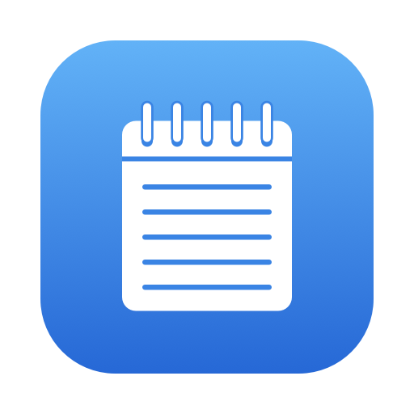
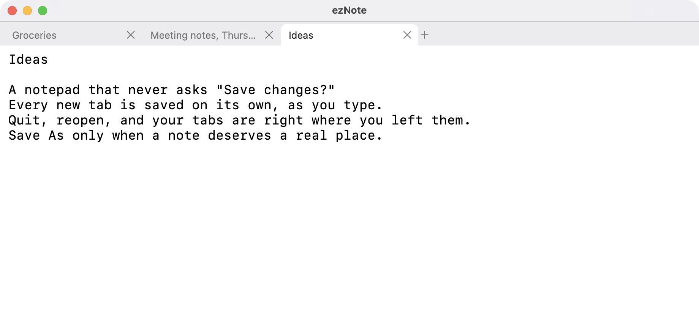
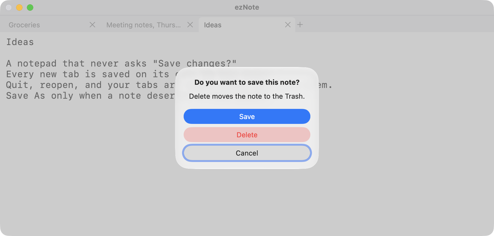

<p align="center">
  
</p>

<h1 align="center">ezNote</h1>

<p align="center">
  <strong>The notepad that never asks “Save changes?”</strong><br />
  Open a tab, type, quit. Your notes are still there next time.
</p>

<p align="center">
  <a href="https://github.com/AvvaMobile/AvvaMobile.ezNote/releases/latest"><strong>Download for macOS</strong></a>
  ·
  <a href="https://avvamobile.github.io/AvvaMobile.ezNote/">Website</a>
  ·
  <a href="https://buymeacoffee.com/muratyilmaz">Buy me a coffee</a>
</p>

<p align="center">
  
</p>

> **Your notes stay yours.** No account, no cloud, no analytics. Every note is a plain `.txt` file in your Documents folder.

## What it does

- **Every new tab is a note that saves itself.** No file name, no location, no Save button. Each tab is a plain `.txt` file in `~/Documents/ezNote`, written as you type.
- **Quit whenever you like.** ezNote never asks anything when you quit. Reopen it and the same tabs come back in the same order, with the same tab selected.
- **Closing a tab is quick.** An empty note closes silently and its file is removed. A note with text asks once: *Save*, *Delete* or *Cancel*. Delete moves the note to the Trash, so nothing is lost by accident.
- **Save As when a note deserves a real place.** From then on that tab works like a classic editor: a dot marks unsaved changes and `⌘S` writes them. If you quit with unsaved changes, they are kept aside and come back on the next launch; the file itself is only written when you press `⌘S`.
- **Plain text only.** UTF-8, line wrapping on, no smart quotes or auto-correct. Paste rich text and you get plain text.
- **Your font, your size.** Pick any font and size in Settings (`⌘,`). Zoom with `⌘+` and `⌘−`.
- **Plays well with other apps.** If a file you have open changes in another app and you have no unsaved edits in that tab, ezNote reloads it.

### One question, only when it counts

ezNote asks something only when you close a tab that still has text in it. Empty tabs just go away, and quitting never asks.



## Keyboard

| Shortcut | Action |
| --- | --- |
| `⌘T` | New tab |
| `⌘W` | Close tab |
| `⌘O` | Open a text file |
| `⌘S` | Save (asks for a location the first time) |
| `⇧⌘S` | Save As |
| `⌘F` | Find |
| `⌘+` / `⌘−` | Zoom in / out (`⌘=` and, on a Turkish Q keyboard, `⌘*` also zoom in) |
| `⌘,` | Settings |

## Install

Download `ezNote-<version>.dmg` from [Releases](https://github.com/AvvaMobile/AvvaMobile.ezNote/releases/latest), open it and drag ezNote to Applications. The app is signed and notarized by Apple.

Requires macOS 14 Sonoma or later, on Apple silicon or Intel.

## Where your notes live

- Notes: `~/Documents/ezNote`, as plain `.txt` files you can open with any editor.
- App state (open tabs, unsaved changes of saved files): `~/Library/Application Support/ezNote`.

## Privacy

ezNote has no account, no cloud and no analytics. It contains no networking code at all. The only time it touches the internet is when you choose *Buy Me a Coffee…*, which opens the page in your browser.

## Support the project

ezNote is free and open source. If it saves you time, you can [buy me a coffee](https://buymeacoffee.com/muratyilmaz).

## Development

```sh
swift test                 # unit tests (core logic and the AppKit layer)
scripts/build-app.sh       # build/ezNote.app, ad-hoc signed, for local use
scripts/release.sh         # signed, notarized DMG uploaded to a draft release; see docs/RELEASING.md
```

Swift Package with two targets: `NotepadCore` (tabs, files, session; no UI) and `Notepad` (the AppKit app). No third-party dependencies. Builds and releases happen locally; there is no CI.

ezNote is an independent app by [Avva Mobile](https://avvamobile.com). MIT licensed.
